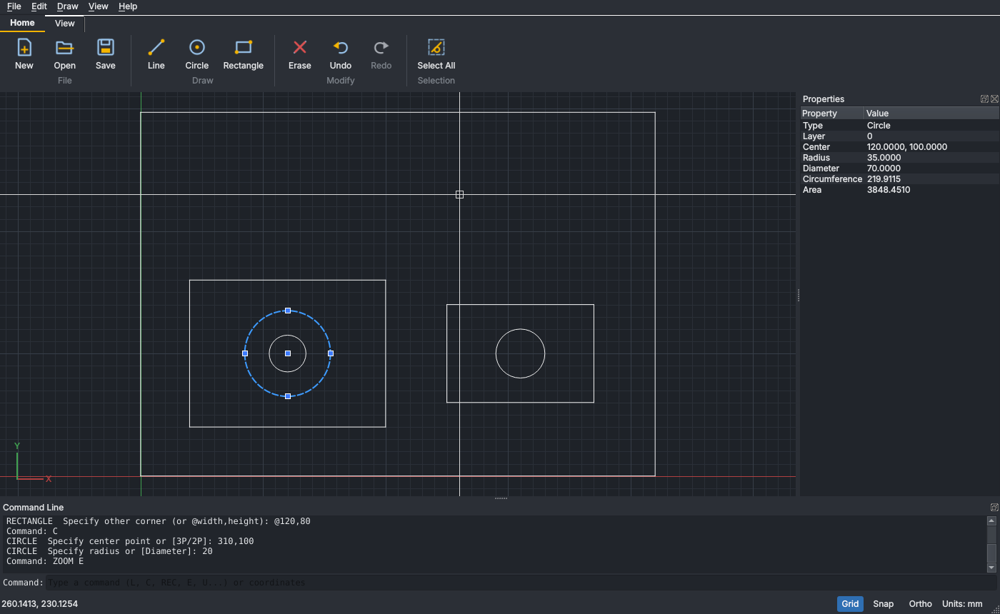

# DYNAMIC CAD

Professional 2D CAD for engineers, fabricators and architects, by **Dynamic Engineers**.



> **Status: Milestone 1 (Phase 1 core + first drawing commands), version 0.1.0.**
> See [docs/STATUS.md](docs/STATUS.md) for exactly what works and what does not yet.

## What works today

| Area | Implemented and tested |
|---|---|
| Window | Ribbon (Home / View), menus, Properties panel, command line, status bar, dark (default) and light theme |
| Canvas | Adaptive grid, X/Y axes, crosshair cursor with pick box, UCS icon, live X,Y coordinates |
| Navigation | Wheel zoom at cursor, middle-drag pan, middle double-click = zoom extents, `ZOOM E/IN/OUT/factor` |
| Drawing | `LINE` (Undo/Close), `CIRCLE` (centre-radius, Diameter, 2P, 3P), `RECTANGLE` |
| Input | `x,y`  `@dx,dy`  `@dist<angle`  `dist<angle`  direct distance entry, GRID (F7), ORTHO (F8), SNAP (F9) |
| Selection | Click, Shift+click to remove, window (drag left to right), crossing (drag right to left), hover highlight, grips |
| Editing | `ERASE` / Delete key, unlimited Undo (Ctrl+Z) / Redo (Ctrl+Y) |
| Files | New, Open, Save, Save As in the native `.dyn` format (bit-exact coordinates, atomic save, unsaved-changes prompt) |

## Using it

Type commands on the keyboard at any time; the text goes to the command line.

| Command | Alias | Example |
|---|---|---|
| LINE | `L` | `L` → `0,0` → `100,0` → `@0,50` → `C` (close) |
| CIRCLE | `C` | `C` → `50,50` → `25` (radius) · `C` → `0,0` → `D` → `40` · `C` → `3P` … |
| RECTANGLE | `REC` | `REC` → `0,0` → `@200,150` |
| ERASE | `E` | select objects, then `E` or the Delete key |
| UNDO / REDO | `U` | Ctrl+Z / Ctrl+Y |
| ZOOM | `Z` | `Z E` (extents), `Z 2`, `Z 0.5` |
| HELP | `?` | lists all commands |

Enter, Space or right-click finishes or repeats a command; Esc cancels.

## Building

Requirements: CMake 3.21 or newer, a C++17 compiler, and **Qt 6.2 or newer** (Core, Gui, Widgets; Qt Test for the tests).

### Windows 10/11 (64-bit)

1. Install **Visual Studio 2022 Community** with the *Desktop development with C++* workload. It is free for
   individuals and small organisations; check Microsoft's licence terms for your company size. The free
   *Build Tools for Visual Studio* is an alternative.
2. Install **Qt 6.5 LTS (or newer) for MSVC 2019/2022 64-bit** with the official open-source online installer
   from qt.io (choose the LGPL/open-source option).
3. Open *x64 Native Tools Command Prompt for VS 2022* and run:

```bat
cd DynamicCAD
cmake -S . -B build -G Ninja -DCMAKE_BUILD_TYPE=Release -DCMAKE_PREFIX_PATH=C:\Qt\6.5.3\msvc2019_64
cmake --build build
ctest --test-dir build --output-on-failure
```

4. To run it on a PC without Qt installed, copy the Qt DLLs next to the exe:

```bat
mkdir dist && copy build\DynamicCAD.exe dist\
C:\Qt\6.5.3\msvc2019_64\bin\windeployqt --release --no-translations dist\DynamicCAD.exe
dist\DynamicCAD.exe
```

GitHub Actions (`.github/workflows/dynamiccad.yml`) runs these same steps on a Windows runner for every push and
uploads a ready-to-run `DynamicCAD-windows-x64` zip.

### Linux (development)

```bash
sudo apt install qt6-base-dev ninja-build cmake g++
cmake -S . -B build -G Ninja && cmake --build build && ctest --test-dir build
./build/DynamicCAD
```

Use `-DDYNCAD_SANITIZE=ON` for an AddressSanitizer + UBSan build.

## Project layout

```
src/geometry   Vec2, BoundingBox, pure geometry algorithms
src/entities   Line, Circle, Polyline (drawing objects)
src/document   Document model, undo stack, edit commands
src/commands   Input parser, command processor, LINE/CIRCLE/RECTANGLE/ERASE
src/selection  Selection set, picking, window/crossing selection
src/canvas     View transform (zoom/pan math), CadCanvas widget
src/fileio     Native .dyn format
src/ui         Main window, ribbon, command line, properties panel, theme, icons
src/app        main()
tests/         8 automated test programs (Qt Test, run via CTest)
docs/          Architecture, roadmap, status, file format, drawing standard
LICENSES/      Third-party notices (shipped with the application)
```

## Licence

DYNAMIC CAD is proprietary software. Copyright © Dynamic Engineers, all rights reserved.
Third-party components and their licences are listed in [LICENSES/THIRD_PARTY_NOTICES.md](LICENSES/THIRD_PARTY_NOTICES.md).
