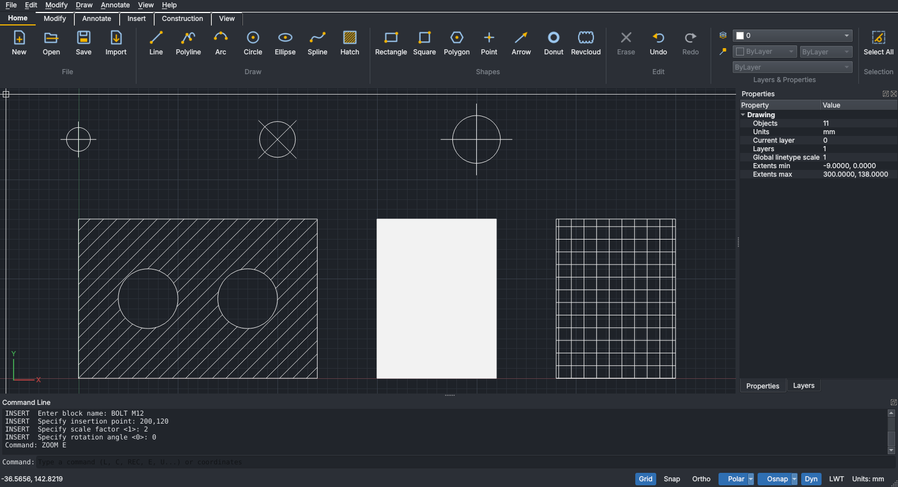
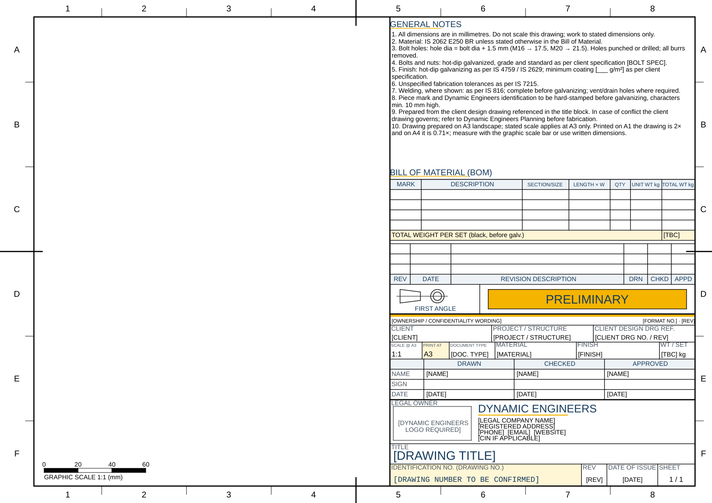
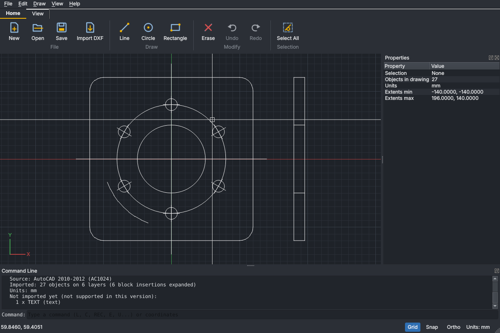

# DYNAMIC CAD

Professional 2D CAD for engineers, fabricators and architects, by **Dynamic Engineers**.



> **Status: version 0.9.0 (pre-release for internal evaluation).** Drawing, editing, layers, text and dimensions,
> blocks and hatching, drawing sheets (Dynamic Engineers A3 master), PDF/printing, DXF import and export, autosave and
> crash recovery are done. DWG is not supported (use DXF). No licence activation yet.
> See [docs/STATUS.md](docs/STATUS.md) for exactly what works and what does not yet.

## What works today

| Area | Implemented and tested |
|---|---|
| Window | Ribbon (Home / View), menus, Properties panel, command line, status bar, dark (default) and light theme |
| Canvas | Adaptive grid, X/Y axes, crosshair cursor with pick box, UCS icon, live X,Y coordinates |
| Navigation | Wheel zoom at cursor, middle-drag pan, middle double-click = zoom extents, `ZOOM E/IN/OUT/factor` |
| Drawing | `LINE`, `PLINE` (lines + arcs, width), `XLINE`, `RAY`, `DONUT`, `REVCLOUD`, `ARC` (3P, centre), `CIRCLE` (radius, Diameter, 2P, 3P), `ELLIPSE`, `SPLINE` (fit points / control vertices), `RECTANGLE` (Fillet, Chamfer, Dimensions), `SQUARE`, `POLYGON` (inscribed, circumscribed, edge), `POINT`, `ARROW` (filled head, size, double) |
| Input | `x,y`  `@dx,dy`  `@dist<angle`  `dist<angle`  direct distance entry, GRID (F7), ORTHO (F8), SNAP (F9) |
| Drafting aids | Object snaps (END, MID, CEN, QUA, INT, PER, TAN, NEA, NOD) with markers and one-shot overrides, polar tracking, ORTHO, dynamic input |
| Selection | Click, Shift+click to remove, window (drag left to right), crossing (drag right to left), hover highlight, grips |
| Editing | `MOVE`, `COPY`, `ROTATE`, `SCALE`, `MIRROR`, `STRETCH`, `ARRAY`, `OFFSET`, `TRIM`, `EXTEND`, `FILLET`, `CHAMFER`, `BREAK`, `JOIN`, `EXPLODE`, `ERASE`, grip editing, Ctrl+C/X/V, unlimited Undo/Redo |
| Annotation | `TEXT`, `MTEXT`, `DIMLINEAR`, `DIMALIGNED`, `DIMANGULAR`, `DIMRADIUS`, `DIMDIAMETER`, `LEADER`, `DIST`, `AREA`, `ID` |
| Blocks & hatch | `BLOCK`, `INSERT`, `EXPLODE`, `PURGE`, nested blocks; `HATCH` (SOLID, ANSI31, ANSI32, ANSI37, NET, LINE, DASH) with islands |
| Sheets & output | `SHEET` (Dynamic Engineers A3 master sheet or ISO A4–A0, at 1:n), `PLOT` (Ctrl+P): vector PDF at exact paper size, print, preview, monochrome, lineweights |
| Safety | Autosave (`SAVETIME`), crash recovery at the next start, Open Recent |
| Layers & properties | Layer manager (on/off, freeze, lock, colour, linetype, lineweight), per-object colour/linetype/lineweight, `MATCHPROP`, editable Properties panel, `LTSCALE`, LWT display |
| Files | New, Open, Open Recent, Save, Save As in the native `.dyn` format (bit-exact coordinates, atomic save, unsaved-changes prompt) |
| DXF export | `DXFOUT` / File → Export DXF: AutoCAD 2000 DXF with layers, linetypes, colours, lineweights, blocks, text, dimensions, hatches |
| DXF import | AutoCAD R12 to 2018 ASCII DXF: lines, circles, arcs, ellipses, splines, solid fills, polylines (incl. curved segments), points, text, MTEXT, dimensions, leaders, hatches, layers, linetypes, units, blocks (nested, scaled, rotated, mirrored, arrays; expanded on import). Everything not imported is listed in a report. |

## Exchanging drawings with AutoCAD

DYNAMIC CAD imports and exports **DXF**. It cannot read or write **DWG** (see
[docs/DWG_EVALUATION.md](docs/DWG_EVALUATION.md)). To bring a DWG across:

1. In AutoCAD: **Save As → AutoCAD 2010 DXF** (or 2013/2018 DXF), keeping the default ASCII format.
2. In DYNAMIC CAD: **File → Open** (or **Import DXF**) and pick the `.dxf` file.
3. Read the import report. It lists anything that was **not** imported in this version (for example paper-space
   layouts, external references, attribute definitions), and you should check the drawing against the original
   before using it.
4. **File → Save As** stores it as a `.dyn` drawing. The original DXF is never overwritten.

Try it with `docs/samples/sample-flange.dxf`.

To send a drawing to AutoCAD users: **File → Export DXF** (or `DXFOUT`). The file uses the AutoCAD 2000 DXF format,
which every AutoCAD release since 2000 opens. Exports pass an independent DXF audit, but have not yet been opened in
AutoCAD itself; please report anything AutoCAD complains about.

## Drawing sheets and PDF

`SHEET` → `DE` → `1:5` → `0,0` inserts the Dynamic Engineers A3 master sheet for a 1:5 drawing (`A4`…`A0` give ISO
sheets). Draw at full size inside it, then `PLOT` (Ctrl+P): the area "Sheet" and scale 1:5 are pre-selected, and
**Export PDF** writes an A3 PDF where 1 mm on paper is exactly 5 mm in the drawing.





## Using it

Type commands on the keyboard at any time; the text goes to the command line.

| Command | Alias | Example |
|---|---|---|
| LINE | `L` | `L` → `0,0` → `100,0` → `@0,50` → `C` (close) |
| PLINE | `PL` | `PL` → `0,0` → `100,0` → `A` (arc mode) → `100,50` → `L` (line mode) → `0,50` → `C` |
| ARC | `A` | `A` → 3 points · `A` → `C` → centre → start → end (or included angle, e.g. `-90`) |
| CIRCLE | `C` | `C` → `50,50` → `25` (radius) · `C` → `0,0` → `D` → `40` · `C` → `3P` … |
| ELLIPSE | `EL` | `EL` → axis end → other axis end → half-length of other axis · `EL` → `C` → centre … |
| SPLINE | `SPL` | `SPL` → points → Enter (curve passes through them) · `SPL` → `M` (control vertices) · `C` closes |
| RECTANGLE | `REC` | `REC` → `0,0` → `@200,150` · `REC` → `F` → `5` (rounded) · `REC` → `0,0` → `D` → `200` → `150` |
| SQUARE | `SQ` | `SQ` → `0,0` → `50` (side) or click the opposite corner |
| POLYGON | `POL` | `POL` → `6` → centre → `I`/`C` → `25` · `POL` → `5` → `E` → two edge points |
| POINT | `PO` | `PO` → `10,20` |
| ARROW | `ARW` | `ARW` → tail → tip · `S` sets head length · `D` toggles double-headed |
| ERASE | `E` | select objects, then `E` or the Delete key |
| UNDO / REDO | `U` | Ctrl+Z / Ctrl+Y |
| ZOOM | `Z` | `Z E` (extents), `Z 2`, `Z 0.5` |
| DXFIN | `IMPORT` | import a DXF file |
| DXFOUT | `EXPORTDXF` | export AutoCAD 2000 DXF |
| SHEET | `TITLEBLOCK` | `SHEET` → `DE` (or `A4`…`A0` → `L`/`P`) → `1:5` → corner |
| PLOT | `PRINT`, Ctrl+P | PDF export, printing, preview |
| SAVETIME | | `SAVETIME 5` (autosave minutes, 0 = off) |
| HELP | `?` | lists all commands |

Enter, Space or right-click finishes or repeats a command; Esc cancels. ZOOM, GRID, SNAP and ORTHO also work in the
middle of a command (as does the AutoCAD-style `'ZOOM`).

## Building

Requirements: CMake 3.21 or newer, a C++17 compiler, and **Qt 6.2 or newer** (Core, Gui, Widgets, PrintSupport; Qt Test for the tests).

### Windows 10/11 (64-bit)

1. Install **Visual Studio 2022 Community** with the *Desktop development with C++* workload. It is free for
   individuals and small organisations; check Microsoft's licence terms for your company size. The free
   *Build Tools for Visual Studio* is an alternative.
2. Install **Qt 6.5 LTS (or newer) for MSVC 2019/2022 64-bit** with the official open-source online installer
   from qt.io (choose the LGPL/open-source option).
3. Open *x64 Native Tools Command Prompt for VS 2022* and run:

```bat
cd DynamicCAD
cmake -S . -B build -G Ninja -DCMAKE_BUILD_TYPE=Release -DCMAKE_PREFIX_PATH=C:\Qt\6.5.3\msvc2019_64
cmake --build build
ctest --test-dir build --output-on-failure
```

4. To run it on a PC without Qt installed, copy the Qt DLLs next to the exe:

```bat
mkdir dist && copy build\DynamicCAD.exe dist\
C:\Qt\6.5.3\msvc2019_64\bin\windeployqt --release --no-translations dist\DynamicCAD.exe
dist\DynamicCAD.exe
```

GitHub Actions (`.github/workflows/dynamiccad.yml`) runs these same steps on a Windows runner for every push and
uploads a ready-to-run `DynamicCAD-windows-x64` zip and the installer `DynamicCAD-Setup-windows-x64`.

### Linux (development)

```bash
sudo apt install qt6-base-dev ninja-build cmake g++
cmake -S . -B build -G Ninja && cmake --build build && ctest --test-dir build
./build/DynamicCAD
```

Use `-DDYNCAD_SANITIZE=ON` for an AddressSanitizer + UBSan build.

## Project layout

```
src/geometry   Vec2, BoundingBox, pure geometry algorithms
src/entities   Drawing objects (lines ... text, dimensions, blocks, hatches)
src/document   Document model, undo stack, edit commands
src/commands   Input parser, command processor, all interactive commands
src/selection  Selection set, picking, window/crossing selection
src/canvas     View transform (zoom/pan math), CadCanvas widget
src/fileio     Native .dyn format, autosave / crash recovery
src/sheets     Paper sizes, plot layout math, sheet templates (title blocks)
src/dxf        DXF reader and writer (own implementation)
src/ui         Main window, ribbon, command line, panels, plot dialog, theme, icons
src/app        main()
tests/         17 automated test programs (Qt Test, run via CTest) + DXF fixtures
docs/          Architecture, roadmap, status, file format, drawing standard, DWG evaluation, licensing
installer/     NSIS installer script
LICENSES/      Third-party notices (shipped with the application)
```

## Licence

DYNAMIC CAD is proprietary software. Copyright © Dynamic Engineers, all rights reserved.
Third-party components and their licences are listed in [LICENSES/THIRD_PARTY_NOTICES.md](LICENSES/THIRD_PARTY_NOTICES.md).
